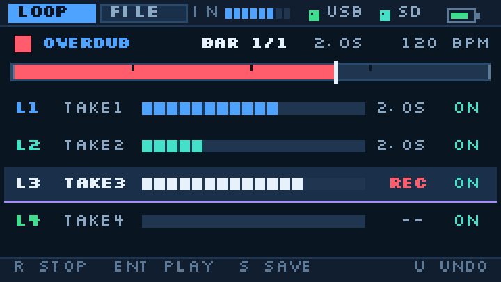

# Cardputer_WaveLooper

240×135、蓝色 UI 的 **USB 音频循环叠录固件**，跑在 M5Stack **Cardputer-Adv** 上。
Cardputer 作为一只 **UAC1 声卡**（设备模式）：PC / Mac / iPhone 把音频推到它，它录成 4 层 loop、叠加、回放，并把混合结果存成 WAV。

> **v0.1.1**：新增 `Fn`+`C` 清除当前选中轨道；可编译、主机侧引擎测试通过（`RESULT OK`），**尚未上机验证**。  
> 构建环境：Arduino-ESP32 **3.3.12**（pioarduino platform **55.03.312**）。  
> 链路与可行性分析见 [docs/设计评估.md](docs/设计评估.md)（含“为什么 EP-136 不能直接接 USB”的第 13 节）。



## 1. 功能

| 模块 | 说明 |
|---|---|
| USB 输入 | UAC1 设备，48 kHz / 16-bit 立体声；PC / Mac / iPhone 免驱（主机播放） |
| 格式转换 | 48 kHz 立体声 → 24 kHz 单声道（4 采样平均），输出 2× 线性插值回 48 kHz |
| Loop | 4 层，长度 = `BARS × 4 × 60 / BPM`，按 240 样本（10 ms）块对齐 |
| 存储 | IMA ADPCM 4-bit，240 样本/块（124 B），24 kHz，约 12 KB/s/层 |
| 默认容量 | 1 小节 @120 BPM = 200 块/层；4 层共 96 KB；池 128 KB |
| 叠录 | 每层从第 1 小节起点对齐；第一层可 1 小节 count-in；第一层按 R 取消，叠录层按 R 提交（尾部静音） |
| 撤销 / 静音 | `U` 删最后一层；`Fn+1..4` 静音/取消静音某层 |
| 清除 | `Fn`+`C` 清除当前选中轨道（其它层保留）；`C` 清空所有层 |
| Loop 模式 | `L` 打开后每圈自动接下一层，直到层满 |
| 节拍器 | 24 kHz click（28 ms，2 kHz 重音 / 1.35 kHz），只进输出，不录进 loop |
| 保存 | `S` 混合所有未静音层 → `/WaveLoop/LOOP_xxxx.WAV`（16-bit 单声道 24 kHz） |
| 文件页 | 列出 `.WAV`、删除、改名；载入留到 v0.2 |
| UI | 240×135 全屏 sprite、30 fps、Wave Blue 主题；顶部 USB/SD/电量与输入电平 |

## 2. 按键

### LOOP 页

| 键 | 动作 |
|---|---|
| `R` / `Space` | 录音 / 取消（第一层）或提交（叠录层） |
| `Enter` | 播放 / 停止 |
| `S` | 保存 WAV（会先停止） |
| `C` | 清空所有层（文件保留） |
| `Fn` + `C` | 清除当前选中的轨道（其它层保留） |
| `U` | 撤销最后一层；录音中按 = 取消本次 take |
| `L` | Loop 模式开 / 关 |
| `Fn` + `1..4` | 静音 / 取消静音 L1–L4 |
| `1..4` | 选中 L1–L4 |
| `;` / `.` | 上 / 下选层 |
| `,` / `/` | BPM −1 / +1（有 loop 时提示 `CLEAR FIRST`） |
| `Fn` + `,` / `/` | BPM −5 / +5 |
| `Fn` + `;` / `.` | BARS + / −（受池容量限制） |
| `M` | 节拍器开 / 关 |
| `G` | 设置浮层 |
| `Tab` | 切到 FILE |
| `Bksp` | 停止 |

### FILE 页

| 键 | 动作 |
|---|---|
| `;` / `.` | 选择文件 |
| `D` | 删除（`Enter` 确认，`Bksp` 取消） |
| `N` | 改名（直接键入；`Enter` 确认，`Bksp` 退格，`Tab` 取消） |
| `Enter` | 载入（v0.1 显示 `LOAD NYI`） |
| `Tab` / `Bksp` | 回 LOOP |

### 设置浮层

`BPM` / `BARS` / `LAYERS` / `CLICK` / `COUNT-IN` / `LOOP`；`;` `.` 选行，`,` `/` 改值，`Enter` 开关或关闭，`Bksp` / `G` / `Tab` 关闭。

## 3. 构建

需要 PlatformIO Core 6.x；首次构建会下载 pioarduino 平台、Arduino 3.3.12 与工具链（约 500 MB）。

```bash
cd firmware
pio run                 # 只编译
pio device monitor      # 可选，115200
```

> ⚠️ 这台机器的 `0x10000` 是 **M5Apps**（自定义分区表），所以不要用 `pio run -t upload`：PlatformIO 会按工程自带的分区表写 `0x10000`，覆盖启动器。烧写走 M5Apps，或只写 app 槽（见下）。

产物：`firmware/.pio/build/cardputer_wavelooper/firmware.bin`（app）；v0.1.1 的 app-only 快照放在仓库根目录，见「根目录的 app 镜像」。

### 主机侧引擎测试

引擎（`loop_audio.cpp`）不依赖 Arduino，可在 PC 上跑：

```bash
cd firmware
python -m ziglang c++ -std=c++17 -O2 -I src test/host/test_engine.cpp src/loop_audio.cpp -o test_engine.exe
./test_engine.exe       # RESULT OK
```

覆盖：BPM/BARS 与容量、ADPCM 误差、录音/自动收尾、分层混音、静音、撤销、部分 take、count-in、层满/清空。

### 根目录的 app 镜像

仓库根目录只保留 **app-only** 镜像（v0.1.1），用于 M5Apps 启动器安装；**不提供合并镜像**：这台 Cardputer 的分区表是 M5Apps 的自定义布局（`apps_app` 在 `0x10000`，WaveLooper 的 app 槽在 `0x1b0000`），把合并镜像写到 `0x0` 会覆盖启动器。

| 文件 | 用途 |
|---|---|
| `CardputerWaveLooper-0.1.1-app.bin` | app-only，交给 M5Apps 安装（落到 `CardputerWaveL…` 槽，`0x1b0000`） |

校验和见 [SHA256SUMS.txt](SHA256SUMS.txt)。推荐直接用 M5Apps 安装，避免 otadata/启动项不一致。

只有在明确知道当前分区表时，才手动烧写 app 槽：

```bash
esptool.py --chip esp32s3 -p COMx -b 460800 write_flash 0x1b0000 CardputerWaveLooper-0.1.1-app.bin
```

**不要写 `0x10000`**——那是 M5Apps 本体；也不要把任何“合并镜像”写到 `0x0`。

## 4. 内存与容量

`POOL_BYTES = 128 KB`，每层每块 124 B：

| 组合 | 占用 | 说明 |
|---|---:|---|
| 4 层 × 1 小节 @120 BPM | 96 KB | 默认 |
| 2 层 × 2 小节 @120 BPM | 96 KB | 2 轨乐句 |
| 1 层 × 4 小节 @120 BPM | 96 KB | 单循环 |
| 4 层 × 1 小节 @90 BPM | 132 KB | 超池 → 自动降为 3 层 |

BPM 越低，1 小节块数越多；`setBpm` 会按容量自动减少 `layers`（UI 显示 `LAYERS` 实际值）。有 loop 时改 BPM / BARS / LAYERS 会被拒绝，先 `C`。

## 5. 已知限制（v0.1）

1. **只做设备模式**：Cardputer 是声卡，PC/手机是主机。它**不能**直接接 EP-136 这类需要 Cardputer 当 USB 主机的声卡；原因与替代方案见 [docs/设计评估.md](docs/设计评估.md) 第 13 节。
2. **未上机验证**：编译与主机测试通过，但 USB 枚举、ES8311 时钟、实际延迟/丢音需真机确认。
3. **24 kHz / 4-bit ADPCM**：低保真；16-bit 档、WAV 载入、BLE MIDI 未做。
4. **BPM 锁定**：有 loop 时不能改 BPM/BARS/LAYERS（改的是样本长度）。
5. **USB 主机模式未做**：没有 UAC host、没有 USB MIDI host。
6. **USB 补丁**：已带 KeySpeaker 的 IAD 描述符补丁与 TinyUSB ISO 重开保护（`src/UsbAudioDesc.h`、`src/UsbIsoFix.h`），但未在真机复测。
7. **无 SD 可录不可存**：loop 在 RAM，`S` 提示 `NO SD`。

## 6. 目录

```
docs/设计评估.md       # 可行性、内存账本、EP-136 链路分析
docs/ui/*.png          # UI mockup（3×）
firmware/src/
  main.cpp             # 按键、NVS、SD、任务接线
  loop_audio.*         # 样本级引擎：4 层、ADPCM、录音/混音（纯 C++）
  usb_audio.*          # USBAudioCard 接线、48k→24k ring
  audio_out.*          # I2S + ES8311 48k、2× 上采样
  wav_store.*          # 混合导出 WAV
  ui.*                 # 240×135 蓝主题界面
  library.*            # /WaveLoop 的 .wav 扫描
  UsbAudioDesc.h       # Windows IAD 补丁（KeySpeaker, MIT）
  UsbIsoFix.h          # TinyUSB ISO 重开补丁（KeySpeaker, MIT）
  usb_patches.cpp      # 两个 --wrap 补丁的编译单元
firmware/test/host/    # PC 侧引擎测试
tools/make_ui_mockups.py
```

## 7. 设计要点

- **时基**：音频任务每次处理 240 个 24 kHz 样本（10 ms），`_phaseBlock` 按块推进；录音/回放/click 同源。
- **分层**：每层独立 ADPCM 缓冲；回放求和 + 软限幅；`U` 按录制顺序回退。
- **对齐**：每层从 phase 0 开始录，第一层可 count-in 1 小节；后续层等相位回 0 再开录。
- **并发**：UI 任务只通过 `request()` 发走带命令，音频任务在块边界用 `_req.exchange(0)` 执行，避免两边同时改状态。

## 8. 许可与致谢

MIT（见 [LICENSE](LICENSE)）。

- UI 版式、按键模型与 `font8.h` 点阵来自 [MidiLooper](https://github.com/saxon267/Cardputer_MidiLooper)（MIT）；字体为 Silkscreen（SIL OFL 1.1）。
- USB 描述符 IAD 补丁与 TinyUSB ISO 保护改自 [Cardputer-ADV KeySpeaker](https://github.com/kariagepompadour/Cardputer-ADV-KeySpeaker)（MIT）。
- M5Unified / M5GFX / M5Cardputer（MIT），arduino-esp32 `USBAudioCard`（Apache-2.0）。
