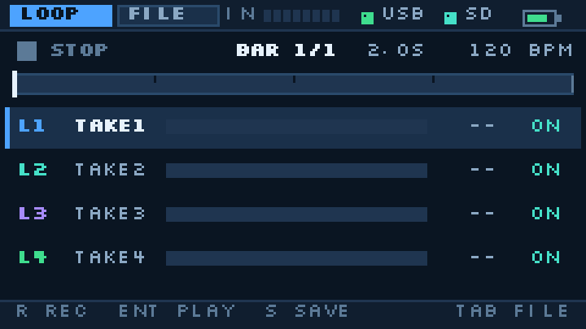
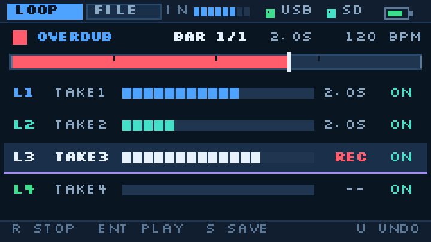
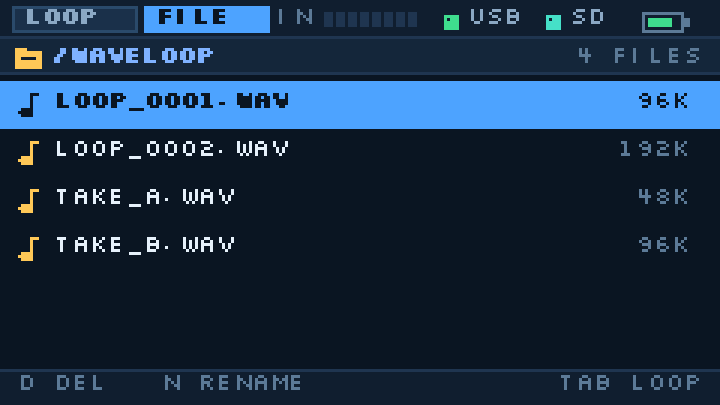
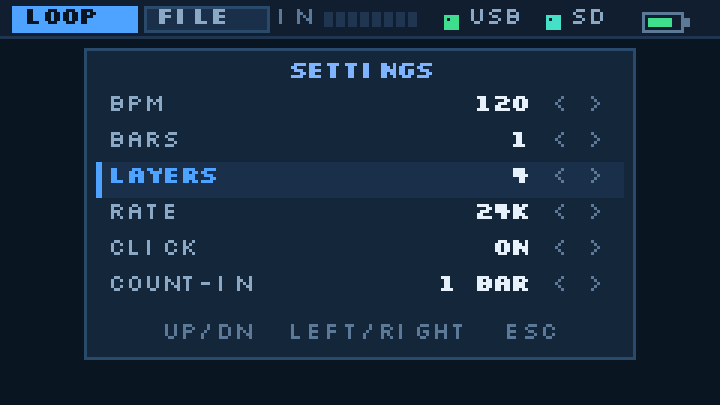

# Cardputer_WaveLooper 设计评估

> 对象：M5Stack Cardputer-Adv（ESP32-S3FN8）+ USB 音频输入的循环叠录固件  
> 评估日期：2026-11-10  
> 需求输入：① 操作逻辑、逻辑、UI 风格沿用 MidiLooper，主色改蓝；② 接收外界通过 USB 传入的音频信号，做 Looper 音频处理  
> 基线：MidiLooper v1.2.0（已上机）、Cardputer_MIDI v0.8.2、Cardputer_MPC、`MidiLooper/docs/SLOOP_到_Cardputer_移植可行性评估.md`  
> 证据口径：本仓库代码逐行核对；同型号真机数据取自 Cardputer-ADV KeySpeaker 的 UAC1 实测（8 h 47 min 无丢音）；平台能力取自 arduino-esp32 / ESP-IDF 组件文档；EP-136 规格取自 TE 产品页/FAQ 与サンレコ评测

> **v1.1 修订（2026-11-10，按实际链路）**：实测链路是 **吉他 → 效果器 → EP-136 → USB → Cardputer**。EP-136 是 24-bit/48k、8 进 4 出的 class-compliant USB 声卡，Cardputer 在这条链路里必须做 **UAC 主机**；ESP32-S3 只有全速 USB + UAC1 主机驱动，**这条 USB 链路基本走不通**（第 13 节）。改成 **EP-136 线路输出 → Grove I2S ADC** 后项目仍然可行；第 4/5/6/7 节的引擎、内存、UI 结论不变。

> **实现状态（v0.1，2026-11-10）**：已按 13.4 A0（PC 中转 / UAC 设备）实现第一版固件并编译通过（主机侧引擎测试 `RESULT OK`），见仓库 `README.md`；尚未上机验证。

**一句话结论：项目可行（4/5），但你这条链路里的“USB”这一段不行——EP-136 是 24-bit/48k、8 进 4 出的声卡（带宽上要求 USB HS，基本是 UAC2），ESP32-S3 只有全速 USB + UAC1 主机驱动，带宽和类版本都对不上。把输入改成模拟（EP-136 线路输出 → Grove I2S ADC），项目回到 4.5/5；内存、UI、分层引擎的结论全部不变。见第 13 节。**

---

## 0. 结论摘要

| 维度 | 评分 | 说明 |
|---|---:|---|
| 需求可行性（PC/手机当主机，设备模式） | **4 / 5** | `USBAudioCard` 现成、同型号实测；loop 长度受内存硬约束 |
| 需求可行性（**实际链路**：EP-136 当声卡） | **1 / 5** | 8 进 4 出/24-bit（HS/UAC2）vs S3 全速 + UAC1，见第 13 节 |
| 改模拟输入后 | **4.5 / 5** | EP-136 线路输出 → Grove I2S ADC，见 13.4 A |
| MidiLooper 复用度 | **3.5 / 5** | UI / 按键 / NVS / 文件管理约 70–80% 可用；循环引擎必须重写 |
| 工作量 | 中高 | 约 **102–142 h**（模拟输入路线；UAC 开发旁路另加 8–16 h） |
| 最大风险 | **内存（硬约束）** | 16-bit / 24 kHz 只够 1 小节；4 层要 4-bit ADPCM |
| 第二风险 | 输入前端 | 模拟路线要加 ADC 单元 + Grove 引脚；USB 主机路线已被 13.2 否决 |
| 建议 | **做** | 但先定第 5 节的 5 个语义；M0 做线路输入，不写 UI |

**开工前必须定的 5 件事**（见第 5 节）：

1. 循环长度：池 96–128 KB，`BARS × LAYERS × RATE` 是一个三角约束，不能三个都要。
2. USB 角色：实际链路要求 Cardputer 当 **UAC 主机**（EP-136 是声卡）→ 13.2 已判定不可行；v1 走 **模拟输入**（13.4 A）。设备模式只保留为开发旁路（13.4 A0）。
3. 叠录模型：**分层**（推荐，直接映射 4 lane）还是单缓冲原地叠加。
4. 起录方式：count-in + 小节对齐（推荐），不是 MidiLooper 的“第一个音符定原点”。
5. 平台：成品（模拟输入）可以留在 **Arduino 2.0.17**（MidiLooper 已验证）；只有做 PC 中转开发旁路才需要迁 **Arduino 3.3.x**。

---

## 1. 需求转译

### 1.1 两条需求在工程上是什么

| # | 需求 | 工程含义 | 现状判断 |
|---|---|---|---|
| 1 | 操作逻辑 / UI 沿用 MidiLooper | `R`/`Enter`/`S`/`C`/`U`/`L`/`M`/`G`/`Tab`、4 条 lane、进度条、设置浮层、FILE 页 | v1.2.0 全部有，版式常量可逐像素复用；**语义要换**（事件→样本） |
| 1b | 蓝色主色 | 只换色板，不改版式 | 只需替换 `config.h` 的 18 个色值（含 4 个 lane 色）；见 7.2 |
| 2 | 接收外界通过 USB 传入的音频 | USB-C 作为 **UAC1 设备**（主机往它播放）或 **UAC 主机**（它去采 USB 话筒/声卡） | 设备模式有现成类 + 同型号实测；**你的链路是主机模式，13.2 判定不可行** |
| 2b | Looper 音频处理 | 录音 / 叠录 / 回放 / 保存，样本级循环，实时 | **全新引擎**；MidiLooper 的 tick 引擎不能直接用于音频 |

### 1.2 “USB 音频输入”有两种读法，先选一个

这一条是整个评估的分水岭，必须先和需求方确认：

| 读法 | 拓扑 | 谁当 USB 主机 | 典型场景 | 本评估 |
|---|---|---|---|---|
| **A. 设备模式** | PC/手机 → USB-C → Cardputer（声卡） | 对端设备 | 把电脑/手机里播放的音乐、伴奏、采样循环起来 | 开发旁路（13.4 A0） |
| B. 主机模式 | USB 声卡/话筒 → USB-C → Cardputer | Cardputer | 吉他/人声直接进 loop（真正的乐器 looper） | **实际链路；13.2 判定不可行** |

读法 A 里，Cardputer 在主机看来就是一只“扬声器”，主机把音频流推给它；它录下来、叠起来、再从自己的喇叭/耳机放出来。

> **2026-11-10 更新**：你确认的链路是 **B**（EP-136 当声卡、Cardputer 当主机）。这正是本评估里风险最高的一条——第 13 节的结论是它在 Cardputer-Adv 上走不通，改走模拟输入。

> 之所以强调这一点：Cardputer-Adv **没有线路输入**（3.5 mm 只出不进，见 KeySpeaker 仓库 `docs/DESIGN.md` 4.4），板载话筒又和扬声器共用 BCK/WS、不能边录边放（同仓库固件 S10-1）。所以“USB 是唯一可用的外部音频入口”这个前提是成立的，不是设计偷懒。

---

## 2. 硬件与平台：先把不可协商的事实钉死

### 2.1 硬指标

| 项 | 事实 | 对 WaveLooper 的影响 |
|---|---|---|
| SoC | ESP32-S3FN8，2×LX7 @240 MHz，**512 KB SRAM，无 PSRAM** | 循环池上限 ≈ 128 KB（见第 4 节） |
| Flash | 8 MB；当前分区 app 3 MB + spiffs 0.875 MB + coredump，**后 4 MB 未用** | 可加音频分区，但实时 loop 不能放 flash（见 4.4） |
| 屏幕 | 240×135 ST7789V2 | 全屏 16 bpp sprite = **64.8 KB**（240×135×2 B），固定开销 |
| 音频输出 | ES8311 单声道 codec + 1 W 喇叭 + 3.5 mm 耳机口（**仅输出**） | 单声道；插耳机自动断喇叭 |
| 麦克风 | ES8311 ADC + 板载 mic；**与扬声器共用 BCK/WS，不能同时工作** | 话筒不能做 looper 输入（录的时候听不到 loop） |
| USB | 单口 USB-C，OTG；同一时刻**只能设备或主机**二选一 | 做 UAC 设备就不能再当 USB MIDI host |
| 供电 | 设备模式由主机供电/充电；主机模式需外设自供电，或 Cardputer 能对外供 5V（待实测） | MidiLooper 的 FM-1 是自供电的 |

依据：`Cardputer_MPC/docs/可行性评估.md:3,33,60`、`MidiLooper/firmware/platformio.ini:1`、KeySpeaker 仓库 `docs/DESIGN.md` 4.3–4.4。

### 2.2 工具链：为什么必须离开 Arduino 2.0.17

MidiLooper 现在跑在 `espressif32@6.9.0`（Arduino-ESP32 **2.0.17**，IDF 4.4.x）上，这套栈**没有** UAC：

| 能力 | Arduino 2.0.17（IDF 4.4） | Arduino 3.3.x（IDF 5.x） |
|---|---|---|
| USB Host MIDI | ✅ MidiLooper 已在用 | ✅ |
| USB Host UAC（`usb_host_uac`） | ❌ 组件要求 **IDF ≥ 5.0** | ✅（但 Arduino 侧无现成类，需引入 IDF 组件） |
| USB Device UAC（`USBAudioCard`） | ❌ 类不存在 | ✅ 核心自带（PR #12466，2026-04） |
| M5Cardputer / M5Unified / M5GFX | ✅ 现版本 | ✅ 同型号 KeySpeaker 用 `m5stack:esp32 3.3.10` 跑通 |

所以只要走 USB 音频，第一件事就是**把工程迁到 Arduino 3.3.x 并验证 USB**。KeySpeaker 的构建脚本给了一份可用的目标配置：`m5stack:esp32 3.3.10`、USB Mode = USB-OTG（TinyUSB）、CDC on boot、8 MB / `default_8MB`。

> **2026-11-10 修订**：按实际链路，成品走 13.4 A 的模拟输入——**这一节整段不适用**，工程可以留在 MidiLooper 已经验证的 Arduino 2.0.17 上；只有做 13.4 A0 的 PC 中转开发旁路时才需要迁 3.3.x。

### 2.3 同型号已经验证过的 UAC 事实（关键证据）

Cardputer-ADV KeySpeaker 把 Cardputer-Adv 当**USB 声卡**（UAC1，48 kHz，16 bit）用，实测了 8 h 47 min 无丢音，结论直接可搬到 WaveLooper：

| 现象 | 事实 | 对本项目的意义 |
|---|---|---|
| 枚举 | UAC1 48 kHz / 16 bit；macOS、Windows 11、iPhone 15 免驱 | 设备模式可行 |
| 时钟 | UAC1 adaptive、**无反馈端点**；主机与 I2S 约差 **10–17 ppm** | 必须做水位重采样，否则约 **1.39 h** 丢一次音 |
| 修复 | 环形缓冲水位 → ±200 ppm → 4 点 Hermite 重采样；修正后稳定（0.35 cent，听不出） | `RateAdjust.h` 可直接借用（MIT） |
| 暂停/恢复 | TinyUSB 0.20.1 重开 ISO OUT 端点时 DWC2 卡死 → 看门狗重启 | 必须打 `--wrap=dcd_edpt_iso_activate` 补丁 |
| Windows | 描述符没有 IAD → 设备“无法启动（Code 10）” | 必须打 `--wrap=tinyusb_enable_interface` 补丁 |
| 事件任务 | 核心的 USB 事件任务栈只有 **2 KB**，在里面打日志会重启 | 事件只记录，日志放到 `loop()` |

这些是“别人替你踩过的坑”，比任何可行性推断都值钱。KeySpeaker 以 MIT 发布，`UsbIsoFix.h` / `RateAdjust.h` / `UsbAudioDesc.h` 的思路和代码可以带版权声明复用。

---

## 3. MidiLooper 可复用的资产（按代码核对）

| 资产 | 位置 | 复用度 | 说明 |
|---|---|---:|---|
| UI 框架 | `firmware/src/ui.cpp` | **85%** | sprite、文字、图标、tab、topbar、progress、settings/delete/rename/toast/boot 全套；版式常量逐像素可用 |
| 4 lane 行 + 18 格电平 | `ui.cpp:167-206` | **80%** | 只换数据源：事件计数 → 层电平/层时长 |
| 按键状态机 | `main.cpp:441-645` | **90%** | 去抖、Fn 层、重命名逐字输入、模态优先级、`;`/`.`/`,`/`/` 映射 |
| NVS 设置 | `main.cpp:686-700` | **90%** | 键名换掉即可 |
| 文件库 / 删除 / 改名 | `library.cpp` + `main.cpp:196-347` | **85%** | 扩展名 `.mid` → `.wav`，路径 `/WaveLoop` |
| 音频任务骨架 | `audio.cpp` | **70%** | I2S + ES8311 + click 合成 + CPU 统计齐了；采样率 44.1k → 48k，click 表重算 |
| 循环“相位”思路 | `loop.cpp:470-533` | **40%** | `_phaseQ16` 以音频帧推进、边界与节拍同源，这个思路直接可用；事件表/量化/双缓冲合并不适用 |
| 主机侧测试结构 | `test/host/` | **60%** | 纯 C++ + stub 的搭法可用；用例要按音频重写 |
| Web 模拟器 | `web/app.js` | **30%** | 版式与交互演示可用；音频引擎无法在浏览器里等价模拟 |
| SMF writer | `loop_store.cpp` | **0%** | 换成 WAV writer（更简单，44 字节头 + PCM） |
| USB MIDI Host | `usb_midi_host.cpp` | **0%** | 换成 UAC 设备；两者不能共存 |

**必须重写的**：循环引擎（样本级录音/分层/混音/边界）、叠录语义、保存/载入、USB 音频接入、漂移重采样。这些恰好是 WaveLooper 的全部核心，所以“沿用 MidiLooper”主要是沿用**交互与外观**，不是沿用引擎。

---

## 4. 决定性约束：循环长度 × 内存

### 4.1 内存账本（Cardputer-Adv，327,680 B 可分配区，约 328 KB）

| 项 | KB | 依据 |
|---|---:|---|
| 框架 / 静态（不含循环池） | 46 | MidiLooper 静态 210 KB − 事件池 164 KB（`MidiLooper/README.md:226-231`、`loop.h:113-115`） |
| UI sprite 240×135×16 bpp | 64.8 | `ui.cpp:18-19`；README 同口径（240×135×2 B） |
| 输入环形缓冲（UART/USB，20–40 ms @48k mono） | 4–8 | 本设计 |
| **循环池** | **96–128** | 本设计，见 4.3 |
| 栈 / DMA / 混音临时区 | 16 | 3 个任务栈 + I2S 双缓冲 + 重采样历史 |
| 余量（heap 碎片） | 60–90 | 别用光 |
| **合计** | **≈ 328** | = 327,680 B |

对照：MidiLooper 用 164 KB 事件池 + 65 KB sprite 跑得很稳；KeySpeaker 在 65 KB 画布 + 48 KB USB 环下实测空闲 heap 约 **107 KB**（开 BLE 后 32 KB）。所以 **96–128 KB 的循环池是现实的，144 KB 以上就开始挤压**。

### 4.2 每种格式“一小节”要多少字节

4/4、1 小节 = `240 / BPM` 秒；120 BPM 时正好 2.0 s。

| 采样率 | 16-bit | 4-bit ADPCM | 备注 |
|---|---:|---:|---|
| 48 kHz | 192 KB | 48 KB | USB 原生，但 16-bit 一小节就 192 KB |
| 44.1 kHz | 176.4 KB | 44.1 KB | 与 48k 无整数比，重采样更贵 |
| 32 kHz | 128 KB | 32 KB | 16-bit 一小节刚好卡在池上限 |
| 24 kHz | 96 KB | 24 KB | **与 48k 是 2:1，重采样最便宜** |
| 22.05 kHz | 88.2 KB | 22.05 KB | 与 44.1k 是 2:1 |
| 16 kHz | 64 KB | 16 KB | 4-bit 可装 8 小节（16 s，128 KB） |

### 4.3 池能装多少：可落地的组合

池按 **128 KB** 算；标 96 KB 的组合在 96 KB 池下同样成立：

| 组合 | 占用 | 音质 | 适用 |
|---|---:|---|---|
| 4 层 × 1 小节 @24k / 4-bit | **96 KB** | 低保真（SK-1 味） | **默认**：4 轨 jam，直接映射 4 lane |
| 2 层 × 2 小节 @24k / 4-bit | 96 KB | 低保真 | 2 轨乐句，更适合旋律/pad |
| 4 层 × 2 小节 @16k / 4-bit | 128 KB | 更低保真 | 4 轨 + 2 小节 |
| 1 层 × 4 小节 @24k / 4-bit | 96 KB | 低保真 | 单循环 + 无限原地叠录（无 undo） |
| 1 层 × 1 小节 @24k / 16-bit | 96 KB | 好 | 单循环（16-bit） |
| 1 层 × 2 小节 @16k / 16-bit | 128 KB | 中 | 2 小节 + 16-bit（保真优先） |
| 1 层 × 8 小节 @16k / 4-bit | 128 KB | 极低保真 | 极限长度（16 s） |
| 2 层 × 1 小节 @24k / 16-bit | 192 KB | 好 | ❌ 超池 |
| 4 层 × 1 小节 @24k / 16-bit | 384 KB | 好 | ❌ 需要 3 倍内存 |

**推荐默认**：`4 层 × 1 小节 @ 24 kHz / IMA ADPCM 4-bit`（96 KB），设置里 `LAYERS` 可选 4/2/1、`BARS` 随之联动，池不够时自动降级并显示 `MAX n BAR`。

### 4.4 为什么不能拿 SD / flash / PSRAM 补救

- **PSRAM**：Cardputer-Adv 的 ESP32-S3FN8 没有 PSRAM（三份本仓库评估 + KeySpeaker 4.3 一致）。焊在板上的 StampS3 模块换不了。
- **SD**：随机读 1–3 ms、卡内 GC 100–250 ms（`Cardputer_MPC/docs/可行性评估.md:100-104`）。实时录制/叠录时一次 GC 就是一声爆音；只适合“存成品”。
- **Flash（后 4 MB 未用）**：擦除 4 KB 扇区会关 cache，几十 ms 的停顿，且 loop 反复写会磨损。可以存**成品 WAV**，不能当实时 loop 的存储。
- **PSRAM 变体**：能挪的只有冷数据；音频回调里的随机读写进 PSRAM 会直接欠载（同一个结论在 `MidiLooper/docs/SLOOP_到_Cardputer_移植可行性评估.md:118-121` 已经写过）。

**结论：循环池必须在内部 SRAM；循环长度是产品定义问题，不是优化问题。** 8 小节 @16k/4-bit 单层（16 s / 128 KB）就是这台机器的极限；想要“正常 looper”的音质和长度，只能换带 PSRAM 的板子（Tab5 / ESP32-P4 方案）。

---

## 5. 必须开工前定的 5 个语义

这五条和 MIDI Looper 当时那四个语义是同一性质：不定，做出来就是“能录、不能叠、循环不对拍”。

### 5.1 循环长度：由 `BPM × BARS` 决定，样本级精确

- `loopSamples = round(BARS × 4 × 60 / BPM × RATE)`（4/4，`RATE` 取 24 kHz 时 120 BPM / 1 小节 = 48,000 样本）。
- 音频没有“第一个音符定原点”这回事。起录必须由 **count-in + 小节边界**触发，样本数按上式算准。
- **录制中不允许改 BPM / BARS**（与 MidiLooper 的“录音中禁改 BPM”同理，但这里更硬：改 BPM 就改了循环的样本长度）。
- 有 loop 时改 BPM → `CLEAR FIRST`；音频不能像 MIDI 那样整体变速（会变调），要变速只能换音高或做时间伸缩，v1 不做。
- BARS 的可选值由 `BPM` 与当前 `LAYERS` 反算：`maxBars = poolBytes / (LAYERS × RATE × bytesPerSample × 240/BPM)`，UI 显示 `MAX n BAR`，超出的选项置灰。

### 5.2 叠录模型：分层，而不是单缓冲原地叠加

| 方案 | 内存 | Undo | Mute | 与 4 lane UI 的对应 |
|---|---|---|---|---|
| 单缓冲原地叠加 | 1 份 | ❌（要影子缓冲 = 2 份） | ❌ | 4 行没有意义 |
| **分层（推荐）** | 4 份（可配 2/1） | ✅ 删最后一层 | ✅ 每层独立 | **一一对应**：L1–L4 = 4 个 take |

分层的关键点：

- 每层都有完整长度，**未录的部分是静音**；回放时把所有未静音层相加。
- 按 `R` 时如果当前层为空 → 录这一层；层满 → `LAYER FULL`；池满 → `POOL FULL`。
- `U` = 丢弃最后录的那一层；`Fn+1..4` = 静音/取消静音某层；`C` = 清空全部层（保留文件）。
- 这正好把 MidiLooper 的 4 lane（CH1/2/3/10）换成 4 层（L1–L4），`laneRow` 的行高、18 格电平、选中态、闪动全部照搬。

### 5.3 起录：count-in + 小节对齐（不是“首音触发”）

- 音频的“首音”受门限、噪声、USB 延迟影响，不可靠；用 **1 小节 count-in**，在下一小节起点精确开录。
- 开录那一刻，环形缓冲里已经存了 20–40 ms 的“过去”。音频任务可以从环里取**小节边界对应的那段样本**做 loop 的第 0 个样本，做到样本级对齐且不丢头（这是 MidiLooper 没有、但音频必须有的一步）。
- 第一层录制中按 `R` = **取消本次 take**（丢弃，回 `STOP`）——截断的音频 loop 没有音乐意义，不能像 MIDI 那样“提前收尾 + 补静音”。
- 叠录层录制中按 `R` = **提交当前层**（后面补静音），循环继续放。
- 监听：录制时输入信号必须同时混入输出，否则演奏者听不到自己。监听音量独立设置（`MON`）。

### 5.4 USB 角色：设备 vs 主机（按实际链路已改为模拟输入）

> ⚠️ **2026-11-10 修订**：实际链路是 EP-136 → USB → Cardputer，Cardputer 必须当 **主机**（本节 B），而 B 已被 13.2 判定不可行。本节 A 只适用于“PC/手机当主机”的开发旁路（13.4 A0）；成品走 13.4 A 的模拟输入。

| | A. UAC 设备（开发旁路） | B. UAC 主机（实际链路） |
|---|---|---|
| 现成代码 | `USBAudioCard`（Arduino 3.3.x 核心自带） | `usb_host_uac` 组件（IDF ≥ 5.0，S2/S3/P4） |
| 同型号实测 | ✅ KeySpeaker 8 h 47 min | ❌ 无 |
| 主机是谁 | PC / 手机 / 平板 / 主机 | Cardputer |
| 供电 | 主机给 Cardputer 供电 | Cardputer 要给外设供电（FM-1 那种自供电设备才行） |
| 延迟敏感度 | 低（源是播放内容，不是乐器） | 高（乐器跟手） |
| 工作量 | 小 | 大：要 IDF 工程或组件移植，+40–80 h；且 13.2 判定 8ch 带宽走不通 |
| 限制 | 不能同时当 USB MIDI host | 只支持 UAC1 外设；供电受限 |

**结论**：按你确认的链路，B 才是实际需求，但 13.2 判定 B 在 Cardputer-Adv 上走不通；A 保留为 PC 中转的开发旁路（13.4 A0）。成品走 13.4 A 的模拟输入——两套 USB 栈、两种电源拓扑、两种延迟指标，不要在 v1 里同时做。

### 5.5 保存 / 载入 / 与 BPM 的关系

- 保存：所有未静音层混音 → 16-bit 单声道 WAV（24 kHz）→ `/WaveLoop/LOOP_xxxx.WAV`。1 小节 96 KB；SD 写 100 KB 约几十 ms，**停止播放时写**。
- 载入：只接受 PCM 16-bit、单声道或立体声（混单）、采样率 = 24 kHz 或可整数比；长度必须等于当前 loop 长度（±1%），否则 `LEN MISMATCH`。v1 **不做时间伸缩**。
- 载入时可以用文件时长反推 BPM：`BPM = 240 × BARS / 秒数`（BARS 取 1）；超出池容量直接拒绝。
- 文件名沿用 `LOOP_0001.WAV` 起步，FILE 页只显示 `.wav`。

---

## 6. 音频引擎设计

### 6.1 信号流

> 下图是 A0 开发旁路的 USB 前端；成品 A 路线把最上面两级换成 `EP-136 → ADC → Grove UART`，音频任务及其后完全不变。

```
 PC/手机 ──USB-C(UAC1, 48k stereo 16bit)──▶ USBAudioCard.onData()
                                              │  L+R→mono（留 headroom）
                                              ▼
                                    ring 20–40 ms (StreamBuffer)
                                              │  水位→ppm→Hermite 重采样
                                              ▼
   ┌──────────────── 音频任务 (core1, prio20, 48k/64帧) ────────────────┐
   │  input ──▶ 录音写层(24k, ADPCM 编码)                                 │
   │          └▶ 监听混音 ─┐                                             │
   │  层1..4 回放(解码) ───┼─▶ 求和 ─▶ 软限幅 ─▶ click 混音 ─▶ i2s_write   │
   └─────────────────────────────────────────────────────────────────────┘
                                              │
                                    ES8311 ──▶ 喇叭 / 耳机
```

### 6.2 时钟、漂移、延迟

- **时基**：循环位置用 I2S 帧计数推进（MidiLooper 的 `_phaseQ16` 思路），不用 `millis()`；边界与 click 同源。
- **漂移**：UAC1 无反馈端点，主机与 I2S 差 10–17 ppm（同型号实测）。走 USB 时必须做“水位 → ±200 ppm → 4 点 Hermite 重采样”，否则约 1.39 h 丢一次音。**这是 USB 前端的必做项，不是可选项。** 成品模拟路线不需要 ±ppm 重采样，只需 UART 水位控制（13.5）。
- **延迟预算**：

| 环节 | 低延迟档 | 安全档 |
|---|---:|---:|
| USB 传输 + 攒块 | 2 ms | 2 ms |
| 环形缓冲目标水位 | 20 ms | 60 ms |
| 重采样 + 混音 | < 0.5 ms | < 0.5 ms |
| I2S DMA 6×64 帧 @48k | 8 ms | 8 ms |
| ES8311 + 功放 | ~1 ms | ~1 ms |
| **合计（输入→出声）** | **≈ 31 ms** | **≈ 71 ms** |

KeySpeaker 的目标水位是 100 ms（后期为给 BLE 让内存降到 80 ms、环形缓冲缩到 200 ms），漂移控制器把水位稳在目标附近（S0 记录的填充是 103 ms、区间 98–109 ms）。这说明水位可以收紧，但 20–30 ms 会不会偶发丢音必须实测；设置里给 `LOW / SAFE` 两档，默认 `SAFE`（源是播放内容，71 ms 可接受）。

> 注意：延迟只影响“监听自己”，不影响 loop 内部的样本对齐——录音和回放共用同一个 I2S 时钟。
> 反过来说，如果需求是“接吉他实时跟弹”，71 ms 是不可接受的；这也是 13.4 里模拟输入路线能成立的前提：源是线路/播放内容，不是现场乐器。

### 6.3 录制 / 叠录 / 混音 / 限幅

- 录音：输入重采样到 24 kHz → 写当前层；层内位置 = 循环相位（样本级）。
- 叠录层：只写自己的层，**不动其它层**，所以不需要“读-改-写”，也不会污染已录内容。
- 回放：每块把 4 层解码到临时缓冲求和；未静音层才参与。
- 限幅：求和后做软限幅（`tanh` 近似或峰值检测），避免 4 层相加硬削顶。
- 停止：**5 ms 淡出**再停 I2S 输出。MIDI 那套 `panic()` 不适用，音频要 ramp，否则爆音。
- 层边界：不做事后 all-off；跨界的层自然延续到下一圈。

### 6.4 状态机

```
IDLE ──R──▶ ARMED(COUNT-IN 1 BAR) ──▶ REC_FIRST ──录满──▶ PLAYING
  ▲                │R 取消                  │R 取消              │R
  │                ▼                        ▼                   ▼
  └────────────── IDLE ◀────────────────── IDLE ◀─── OVERDUB(L2..L4)
                                                        │R 提交 / 录满
                                                        ▼
                                                     PLAYING
PLAYING ──Enter──▶ IDLE（淡出 5 ms）
任意态 ──拔 USB──▶ 停止采集、保留已录层、toast USB LOST
```

每层自己的状态：`EMPTY / REC / OK / MUTED`；池满或层满时 `POOL FULL` / `LAYER FULL`，不静默丢样本。

### 6.5 格式与 ADPCM

- I2S 输出固定 **48 kHz**（USB 原生，ES8311 也稳），循环存储用 **24 kHz**（2:1，抽取/插值最便宜）。
- 4-bit IMA ADPCM 按 256 样本一块（128 B + 4 B 头）编码，块边界固定，便于解码/混音；编码器每样本约 20–30 周期，24 kHz 下 < 2% CPU。
- 16-bit 档保留：`LAYERS 1` 时可用（96 KB/小节）；2 层只能装半小节，不建议。

### 6.6 保存 WAV

- 44 字节 RIFF 头 + 16-bit PCM，单声道，24 kHz；长度写 `loopSamples`，不写尾巴静音。
- 写文件在主任务、停止播放时做；分块写并 `yield()`，避免看门狗。
- FILE 页载入时的校验顺序：RIFF/WAVE → fmt(PCM, 16-bit, mono/stereo, 24k) → data 长度 → 池容量。

### 6.7 建议的代码结构

```
firmware/src/
├── main.cpp            # 按键、NVS、SD、任务接线（沿用 MidiLooper）
├── audio.cpp/.h        # I2S + ES8311，48 kHz（改采样率 + click 表重算）
├── line_in.cpp/.h      # 成品输入：Grove UART 帧解析 + 水位控制（EP-136 → ADC）
├── usb_audio.cpp/.h    # 可选开发旁路：USBAudioCard 接线、ring、漂移重采样（13.4 A0）
├── loop_audio.cpp/.h   # 样本级引擎：层、录音/混音/限幅、ADPCM、状态机
├── wav_store.cpp/.h    # WAV writer/reader（替代 loop_store）
├── library.cpp/.h      # /WaveLoop 扫描（沿用，扩展名改 .wav）
├── ui.cpp/.h           # 版式沿用 + 蓝主题
└── config.h            # 引脚、采样率、池大小、色板
test/host/              # 纯 C++ + stub 输入，跑相位/边界/层混音/池溢出
```

`loop_audio` 保持纯 C++、不依赖 Arduino 头文件，这样主机侧测试才能和固件共用同一份代码；输入前端统一抽象成 `SampleSource`（48 k 单声道），成品的 `line_in` 和开发旁路的 `usb_audio` 可以互换，引擎不感知来源。

---

## 7. UI：蓝色主题 + 版式复用

### 7.1 版式（与 `ui.cpp` 常量一一对应）

| 区域 | 常量 | WaveLooper 的变化 |
|---|---|---|
| 顶栏 | 0–12，13 px | 新增 **IN 八段电平**（108–139）；USB/SD 点、电量不动 |
| 标签 | `tab(4)/tab(48)`，42×9 | 不变（LOOP / FILE） |
| 状态行 | y=17 | 图标 + 状态 + `BAR 1/N` + **循环秒数** + BPM |
| 进度条 | `progress(31)`，x=6 w=228 h=7 | 不变；REC 红 / PLAY 蓝 / 停止暗蓝 |
| 层行 | `44 + i×18`，高 17 | `L1`(7) + 名称(30) + **18 格电平**(68–175) + 时长(→204) + ON/OFF(217) |
| 底栏 | 124，11 px | 提示文案随状态变 |

### 7.2 色板（“Wave Blue”）

| 名称 | 用途 | hex | RGB565 | 对 BG 对比度 |
|---|---|---|---:|---:|
| `C_BG` | 背景 | `#0A1522` | 2212 | 1.00 |
| `C_BAR` | 顶/底栏 | `#101E2F` | 4325 | 1.09 |
| `C_PANEL` | 面板 | `#14263A` | 4391 | 1.20 |
| `C_PAD` | 选中行底 | `#1A304A` | 6537 | 1.37 |
| `C_EDGE` | 边框 | `#2A4A6B` | 10829 | 2.00 |
| `C_LINE` | 分隔/电平槽 | `#1F3550` | 6570 | 1.47 |
| `C_TXT` | 主文字 | `#E6F1FB` | 59295 | **16.0** |
| `C_LT2` | 次亮 | `#C3D9EC` | 50909 | 12.7 |
| `C_DIM` | 次文字 | `#8BA8C4` | 36184 | 7.4 |
| `C_FAINT` | 提示文字 | `#5C7A97` | 23506 | 4.1 |
| `C_ACC` | **主色**：选中/播放/进度 | `#4DA3FF` | 19743 | **7.0** |
| `C_ACC_DIM` | 停止态的循环 | `#123A5E` | 4555 | 1.6 |
| `C_AMB` | ARMED / count-in | `#FFC857` | 65098 | 11.9 |
| `C_AQUA` | ON / 层 2 | `#45E0C8` | 18201 | 11.2 |
| `C_BLUE` | 路径 / 标题 | `#7FB2FF` | 32159 | 8.5 |
| `C_PURPLE` | 层 3 | `#A78BFA` | 42079 | 6.8 |
| `C_RED` | REC / OFF | `#FF5D6C` | 64237 | 6.2 |
| `C_GREEN` | PLAY / 层 4 | `#3FDD8E` | 16113 | 10.5 |

对比度按 WCAG 相对亮度算：8 px 点阵字的最小可读对比度建议 ≥ 4.5，`C_FAINT`（4.1）只用于提示级信息（底栏、`IN` 标签、文件大小），主信息一律 ≥ 7。语义色沿用 MidiLooper 的约定（红=录、绿=放、琥珀=待录）；蓝是主色，负责选中、进度与播放高亮。

### 7.3 四个界面

| LOOP 空闲 | LOOP 叠录 |
|---|---|
|  |  |

| FILE | SETTINGS |
|---|---|
|  |  |

四张图由 `tools/make_ui_mockups.py` 生成，**字形直接读 MidiLooper 的 `font8.h`**（Silkscreen 8 px，6×8 格），所以和固件里长出来的一模一样；只有色板和文案是新的。

要点：

- 顶栏 `IN` 是 USB 输入电平：没有流时全暗，有流时按 RMS 点亮；这就是“外界音频进来了”最直观的反馈。
- LOOP 行的 18 格从“事件计数”变成**层电平**；`REC` 时整行随输入闪动（沿用 MidiLooper 的 90 ms 闪动逻辑）。
- 右侧列从“事件数”变成**层时长**（`2.0S`），空层显示 `--`，录制中显示红色 `REC`。
- 状态行加了循环秒数（`2.0S`），因为“1 小节”在不同 BPM 下长度不同，秒数才是用户能感知的。

### 7.4 按键表（与 MidiLooper 的差异）

| 键 | LOOP 页 | 与 MidiLooper |
|---|---|---|
| `R` / `Space` | 录音 / 取消（第一层）或提交（叠录层） | 键位同，语义改（见 5.3） |
| `Enter` | 播放 / 停止（5 ms 淡出） | 同 |
| `S` | 保存 WAV | 同键，格式换 |
| `C` | 清空所有层（文件保留） | 同 |
| `Fn` + `C` | 清除当前选中的那一层 | *新增* |
| `U` | 删最后一层 | 同键，语义从 generation → layer |
| `L` | 自动续录（下一层自动接上） | 同 |
| `Fn` + `1..4` | 静音 / 取消静音 L1–L4 | 同 |
| `1..4` | 选中 L1–L4 | 同 |
| `;` / `.` | 上 / 下选层 | 同 |
| `,` / `/` | BPM −1 / +1（有 loop 时 `CLEAR FIRST`） | 同键，新增锁定 |
| `Fn` + `;` / `.` | BARS + / −（受池限制） | 同键，选项变少 |
| `M` | 节拍器开 / 关 | 同 |
| `G` | 设置浮层 | 同 |
| `Tab` | 切 FILE | 同 |
| `Bksp` | 停止 | 同 |

| 设置项 | 值 | 替代了 MidiLooper 的 |
|---|---|---|
| BPM | 40–240 | BPM |
| BARS | 1 / 2 / 4 / 8（由池与 BPM 反算） | BARS（1–32） |
| LAYERS | 1 / 2 / 4 | *新增* |
| RATE | 16K / 24K / 32K | 替代 QUANT |
| CLICK | ON / OFF | 同 |
| COUNT-IN | OFF / 1 BAR | 同 |

QUANT 与 SWING 在音频 looper 里没有对应物，直接删掉；设置浮层里的这两行让给 LAYERS / RATE。这是“逻辑沿用”里唯一必须破例的地方，要写进 README，否则老用户会找不到量化。

### 7.5 状态与提示

`NO USB`（没枚举）/ `NO STREAM`（枚举了但主机没推流）/ `USB LOST`（录制中掉线）/ `POOL FULL` / `LAYER FULL` / `LEN MISMATCH` / `NO SD` / `SAVE FAIL` / `TAKE CANCELED` / `CLEAR FIRST`。全部走 `drawToast()`，不弹新页。

---

## 8. 任务与实时预算

### 8.1 三个任务

| 任务 | 核 / 优先级 | 干什么 | 绝不干什么 |
|---|---|---|---|
| 输入接收（线路 UART；可选 `USBAudioCard`） | 核心创建 / 音频任务 | 帧解析或 L+R→单声道、写 ring、更新输入峰值 | 不做混音、不打日志（2 KB 栈） |
| 音频任务（新建） | core 1 / 20 | 读 ring、漂移重采样、录音/回放/混音/限幅/click、写 I2S | 不碰 SD、不排序、不分配内存 |
| 主任务（Arduino `loop()`） | core 1 / 1 | 键盘、UI 30 fps、NVS、SD 保存/载入 | 不在音频任务里做这些 |

### 8.2 CPU / 内存估算

- 混音：4 层 × 48 kHz × 约 10 周期 ≈ 2 M cycles/s，< 1% of 240 MHz。
- ADPCM：24 kHz × 约 30 周期 × 2（编+解）≈ 1.4 M cycles/s，< 1%。
- 重采样：48 kHz × 约 20 周期 ≈ 1 M cycles/s，< 1%。
- UI：30 fps × 65 KB sprite push（SPI 40 MHz ≈ 13 ms/帧）≈ 39% 的帧时间，但走 DMA，真正挤占的是 SPI 总线；**SD 写和 UI 刷屏会抢 SPI**，这是实测要盯的点（不是 CPU）。
- 内存：见 4.1，池 96–128 KB 留 60–90 KB 余量。

### 8.3 需要实测的三件事

1. 20–30 ms 水位下连续 2 小时有没有可闻丢音（决定 `LOW` 档能不能给）。
2. 4 层混音 + 30 fps UI + SD 写 WAV 同时发生时，音频任务的最大块耗时（目标 < 8 ms/块）。
3. 拔插 USB、暂停/恢复 10 次，不重启（TinyUSB ISO 补丁是否生效）。

---

## 9. 风险清单

| # | 风险 | 等级 | 证据 / 原因 | 缓解 |
|---|---|---|---|---|
| R1 | 循环长度被内存卡死，产品定义落空 | **高** | 512 KB 无 PSRAM；16-bit/24k 一小节就 96 KB | 先定 4.3 的组合；默认 24k/4-bit；8 小节以上换硬件 |
| R2 | 平台迁移（2.0.17 → 3.3.x）回归 | 中（仅开发旁路） | 只有 A0 的 `USBAudioCard` 需要 3.3.x；成品模拟路线留在 2.0.17 | 成品不迁；做 A0 时单独建 env，别动主工程 |
| R3 | UAC / TinyUSB 稳定性（仅开发旁路 A0） | 中（仅 A0） | ISO 重开挂死（`UsbIsoFix.h`）、Windows 缺 IAD（`UsbAudioDesc.h`）、`USBAudioCard` 较新（PR #12466 review 有保留） | 打两个 `--wrap` 补丁；10 次暂停/恢复测试；成品不依赖它 |
| R11 | 线路输入前端（ADC 板 + Grove UART） | 中 | 48k/5ms 帧的丢帧、供电、Grove 2 根信号线 | 复用 KeySpeaker AUX 单元；帧校验 + 水位；M0 连续 2 h 实测 |
| R4 | 时钟漂移 → 周期性丢音 | 中高 | 同型号实测 10–17 ppm，1.39 h/次 | 水位 + Hermite 重采样（`RateAdjust.h`）；实测 8 h |
| R5 | 监听延迟影响手感 | 中 | 低延迟档约 31 ms，安全档约 71 ms | 两档设置；源是播放内容时默认安全档 |
| R6 | 4-bit ADPCM 音质不被接受 | 中 | 24k/4-bit ≈ SK-1 级 | 保留 16-bit 档（1 层）；M1 结束前做 A/B 试听定档 |
| R7 | SD 保存/载入卡顿 | 中 | 写 96–128 KB；卡内 GC 100–250 ms | 停止时写、分块 + `yield()`；载入先校验再进池 |
| R8 | USB 角色互斥：不能同时当 MIDI host | 中 | 单口 OTG，TinyUSB 设备与 host 不能共存 | 踏板/控制走键盘或后续 BLE MIDI；不要在同版做 host UAC |
| R9 | 话筒不可用（录时听不到 loop） | 低 | 与扬声器共用 BCK/WS（KeySpeaker S10-1） | 不做 mic 输入；USB 是唯一入口 |
| R10 | 与 MidiLooper 双项目抢时间 | 低 | 复用面大但引擎全新 | 先把 MidiLooper 冻结在 v1.2.0，避免双线改 UI |

---

## 10. 里程碑与工作量

| 阶段 | 内容 | 通过标准 | 预估 |
|---|---|---|---:|
| **M0** | 线路输入：PCM1808 + Pico 2（或现成 AUX 单元）+ Grove UART 帧 + 水位控制 | 48 k/16-bit 单声道稳定进入；连续 2 h 无丢帧；端到端延迟实测 | 14–20 h |
| **M1** | 样本级循环引擎：时基、分层、录制/混音/限幅、ADPCM、主机侧测试 | PC 上跑通相位/边界/层混音/池溢出的用例；真机 4 层不掉块 | 32–40 h |
| **M2** | UI 蓝主题 + 4 个界面 + 按键 + NVS | 与 mockup 像素级一致；全部键位可达 | 16–24 h |
| **M3** | WAV 保存/载入 + FILE 页 | 存-读往返一致；长度不符有明确提示 | 12–16 h |
| **M4** | 真机联调：爆音/丢音/延迟/SD/长跑 | 4 层 + 30 fps + SD 写同时进行 2 h 无异常 | 20–30 h |
| **M5** | 文档、README、发布包 | 按键表/限制/刷机顺序写全 | 8–12 h |
| **合计** | | | **102–142 h** |

**停手点（M0 结束必须回答）**：线路输入在 5 ms 帧 + 10 ms 水位下连续 2 小时是否可闻丢帧/爆音？

- 有 → 加水位或缩短帧长；
- 延迟 > 30 ms → 改直接 I2S ADC（13.4 B）；
- 硬件搞不定 → 退回 PC 中转（13.4 A0）做开发，但成品形态不成立，应及时止损。

---

## 11. 依据核对（fact-check）

| # | 声明 | 证据 | 结论 |
|---|---|---|---|
| 1 | Cardputer-Adv 512 KB SRAM、8 MB Flash、无 PSRAM | `Cardputer_MPC/docs/可行性评估.md:3,33`；`MidiLooper/firmware/platformio.ini:1`；KeySpeaker DESIGN 4.3 | 确认 |
| 2 | 3.5 mm 耳机口仅输出，不能线路输入 | KeySpeaker DESIGN 4.4（引 M5Stack 规格） | 确认（文档） |
| 3 | 板载话筒与扬声器共用 BCK/WS，不能同时工作 | KeySpeaker 固件 S10-1 注释 | **待本机复核**（同型号固件实测口径） |
| 4 | Arduino 3.3.x 核心自带 `USBAudioCard`（UAC1 48k 16bit） | `USBAudioCard.h`；arduino-esp32 PR #12466 | 确认 |
| 5 | UAC1 adaptive、无反馈端点，主机/设备约差 10–17 ppm | KeySpeaker DESIGN 4.2 + 实测 | 确认（同型号实测） |
| 6 | 不做漂移修正时约 1.39 h 丢一次音 | KeySpeaker DESIGN 4.2（S0 六小时测试） | 确认（同型号实测） |
| 7 | TinyUSB 0.20.1 在暂停/恢复时卡死 ISO OUT 端点 → 看门狗重启 | `UsbIsoFix.h` 头注释 | 确认（同型号实测） |
| 8 | Windows 缺 IAD 时音频 Code 10 | `UsbAudioDesc.h` 头注释 | 确认（同型号实测） |
| 9 | USB 事件任务栈 2 KB，打日志会重启 | KeySpeaker DESIGN 4.1 | 确认 |
| 10 | `usb_host_uac` 支持 UAC1 主机、RX/TX 独立逻辑设备、要求 IDF ≥ 5.0 | 组件 Readme（v1.5.0） | 确认 |
| 11 | `usb_device_uac` 要求 IDF ≥ 5.0，且 Windows/Linux 不能同时兼容（macOS 需额外宏） | 组件 Readme（v1.3.2） | 确认 |
| 12 | MidiLooper 静态 210,116 B / 327,680 B；事件池 163,840 B（160 KiB） | `MidiLooper/README.md:226-231`、`loop.h:113-115` | 确认 |
| 13 | UI sprite 240×135×16 bpp = 64,800 B（64.8 KB） | `ui.cpp:18-19`、`MidiLooper/README.md:229` | 确认 |
| 14 | 4 lane = CH1/2/3/10，18 格电平，行高 18 | `loop.cpp:566-575`、`ui.cpp:167-206` | 确认 |
| 15 | 循环长度由 bars 决定（480 PPQN） | `loop.h:40` | 确认 |
| 16 | SD 随机读 1–3 ms、卡内 GC 100–250 ms | `Cardputer_MPC/docs/可行性评估.md:100-104` | 确认（项目实测口径） |
| 17 | Arduino 2.0.17 无 UAC 类驱动 | 组件要求 IDF ≥ 5.0 + 2.0.17 对应 IDF 4.4.x | 确认（推断，工具链版本对应） |
| 18 | EP-136 是 USB-C class-compliant 音频/MIDI 接口，iOS/Android/Mac/Windows 免驱 | サンレコ评测；TE FAQ | 确认（公开资料） |
| 19 | EP-136：8 进（4 组立体声）/ 4 出（2 组立体声），24-bit/48k 固定 | Synthtopia；サンレコ规格表 | 确认（公开资料） |
| 20 | EP-136：2×AAA 或 USB-C 总线供电；带立体声输出与耳机 cue | TE 产品页；サンレコ | 确认（公开资料） |
| 21 | ESP32-S3 USB-OTG 仅全速 12 Mbps，无 HS PHY | ESP32-S3 数据手册 | 确认（芯片规格） |
| 22 | `usb_host_uac` 仅支持 UAC 1.0 | 组件 Readme v1.5.0 | 确认 |
| 23 | 8ch × 24-bit × 48 kHz ≈ 1.15 MB/s，超过 FS 等时实际上限 | 计算 | 确认（算术） |
| 24 | EP-136 的 UAC 版本（UAC1/UAC2）与是否有 FS 配置 | 公开资料未写明 | **待真机**（13.3 抓描述符） |

统计：22 条已核实、0 条被推翻、2 条需真机复核。**样本级循环的相位/边界/混音正确性**属于设计推理，本仓库没有音频引擎的可执行模型；M1 必须在 PC 上用 stub 输入跑出可重复的用例（类似 MidiLooper 的 `test/host`），不要只靠听感。

---

## 12. 最终建议

1. **先把循环长度定成产品参数**：默认 `4 层 × 1 小节 @24 kHz / 4-bit = 96 KB`；要 2 小节就切 2 层；8 小节只能在 `1 层 @16k/4-bit` 下做到（16 s，极低保真），再长就换硬件。不要承诺“1–32 小节”这种 MIDI 时代的数字。
2. **放弃 USB 主机这条路**：EP-136 的 8 进 4 出 / 24-bit 在带宽上要求 HS、基本是 UAC2，而 S3 只有全速 + UAC1 主机驱动（第 13 节）；成品改用 **EP-136 线路输出 → Grove I2S ADC**（13.4 A），USB 设备模式只留作 PC 中转的开发旁路（13.4 A0）。
3. **叠录用分层，不用单缓冲**：`U` = 删最后一层、`Fn+1..4` = 静音，这样 MidiLooper 的 4 lane UI 与按键可以原样保留。
4. **起录用 count-in + 小节对齐**，并从环形缓冲里取边界样本补齐开头；第一层按 `R` 取消，叠录层按 `R` 提交。
5. **先做 M0，别先写 UI**：USB 音频的 8 小时稳定性、延迟、暂停/恢复不重启，是唯一能推翻整个方案的东西；UI 已经是四张图定下来的事。
6. **漂移重采样是必做项**：没有它，这个 looper 每小时会“咔”一下，用户会以为是固件坏了。
7. **蓝主题只换色板**：版式、字号、行高、18 格电平全部不动；四个界面的 mockup 已按 `font8.h` 的字形生成，可以直接作为 M2 的验收基准。

---

## 13. 链路修订：吉他 → 效果器 → EP-136 → USB → Cardputer（2026-11-10 追加）

> 你确认的链路。它把 Cardputer 放到 **USB 主机** 的位置，和 5.4 节原来的“设备模式”相反。结论：**这条 USB 链路在 Cardputer-Adv 上基本走不通**；把输入改成模拟，项目仍然可行。

### 13.1 EP-136 是什么

| 项 | 事实 | 出处 |
|---|---|---|
| 定位 | 2 路立体声 + AUX 的小型混音器 / 6 种 FX / 音序器 | TE 产品页 |
| USB | USB-C，class-compliant 音频/MIDI，iOS/Android/Mac/Windows 免驱 | サンレコ、TE FAQ |
| 通道 | **8 进（4 组立体声）/ 4 出（2 组立体声）** | Synthtopia、サンレコ规格表 |
| 格式 | **24-bit / 48 kHz 固定** | サンレコ规格表 |
| 电源 | 2×AAA，或 USB-C 总线供电 | TE 产品页 |
| 模拟 | 2 路立体声输入 + AUX + 立体声输出 + 耳机 cue | サンレコ |
| FX | 含 tempo-sync 的 `LOOP`，2 小节 FX 自动化 | TE 产品页 |

它相对主机是 **UAC 设备**；要拿它的 USB 音频，Cardputer 必须是主机。

### 13.2 为什么 USB 这条路走不通（硬约束）

1. **带宽**：8ch × 24-bit × 48k ≈ **1.15 MB/s**。USB 全速（12 Mbps）等时传输的实际上限约 1.0 MB/s，还要留 OUT 方向——S3 的全速控制器装不下。
2. **速率等级**：24-bit/48k、8 进 4 出、手机/电脑免驱，这组规格基本只能是 **USB 2.0 High-Speed（480 Mbps）+ UAC2**。ESP32-S3 的 USB-OTG 只有 **全速 12 Mbps**，没有 HS PHY。
3. **类驱动**：ESP-IDF 的 `usb_host_uac` 只支持 **UAC 1.0**；UAC2 主机驱动要自己写（描述符、时钟源、采样率控制、等时 IN、24-bit 打包、feedback），而且写完也还是全速。
4. **工具链**：Arduino 侧没有 UAC 主机类（`USBAudioCard` 是设备侧）。要落到 IDF 5.x，M5Cardputer 这个 Arduino 库用不了，显示/键盘要换 M5GFX + 自己写 TCA8418。
5. **供电**：主机模式还要给 EP-136 提供 VBUS（它可用电池，但 USB 设备通常要看到 VBUS 才启动）。Cardputer 的 USB-C 平时是充电/烧写口，能否对外供 5V 需要实测——这是第二道坎。

**结论**：S3 的“全速 + UAC1”与 EP-136 的“HS + UAC2 + 8 声道”不在一个量级，这不是多写几千行能解决的。**不要按 USB 主机立项。**

### 13.3 先做 10 分钟验证（拿到证据再决策）

把 EP-136 接到 Linux PC（Windows 用 USBView / Wireshark USBPcap）：

```
lsusb -v -d <vid:pid> | grep -E "bcdUSB|bInterfaceClass|bInterfaceSubClass|bInterfaceProtocol|bAlternateSetting|wMaxPacketSize|bNrChannels|bBitResolution|bSamFreqType"
```

看四件事：

- `bcdUSB`：`0x0200`/`0x0210` = HS，`0x0110` = FS；
- 音频控制接口 `bInterfaceSubClass`：`0x01` = UAC1，`0x02` = UAC2；
- Streaming alt setting 的通道数 / 位深 / 采样率；
- 有没有 FS 配置。

只有看到 **UAC1 + FS + ≤2 声道**，USB 主机方案才值得立项；否则直接走 13.4。

### 13.4 四条路线

| 路线 | 做法 | 延迟 | 增量工作量 | 结论 |
|---|---|---|---:|---|
| **A. 模拟输入（推荐成品）** | EP-136 立体声输出 → PCM1808 + Pico 2（KeySpeaker AUX 单元）→ Grove UART → Cardputer | ~20–25 ms | 20–30 h | ✅ 不碰 USB 主机；USB-C 留给供电/烧写 |
| A0. PC 中转（开发期） | EP-136 → PC（主机）→ Cardputer（UAC 设备） | 30–50 ms | 8–16 h | ✅ 用现成 `USBAudioCard` 先把引擎/UI 跑起来，不是成品 |
| B. 直接 I2S ADC | EP-136 输出 → I2S ADC → 借 IR/GPIO 的 I2S RX | ~12–15 ms | 25–35 h | ⚠️ 要借 3–4 根引脚，硬件改动大 |
| C. UAC 主机 | IDF 5.x + `usb_host_uac`（仅当 13.3 看到 UAC1/FS） | ~20–30 ms | 40–60 h | ⚠️ 只拿 2 声道，8 进用不上 |
| D. 换主机 | Tab5 / ESP32-P4（HS USB）做 UAC2 主机 | — | — | 不是 Cardputer 了 |

### 13.5 模拟路线怎么做（复用已验证的 AUX 单元）

KeySpeaker 已经在同一块 Cardputer-Adv 上做过“线路输入”：**Pico 2 + PCM1808** 采 48 kHz 单声道，**5 ms 帧**经 Grove UART 送进 Cardputer；有原理图、固件、实测。它正好解决两件事：

- Cardputer 没有线路输入；
- Grove 只有 2 根信号线，而 I2S ADC 需要 BCLK/WS/DIN（+MCLK），引脚不够。

接法：EP-136 的立体声输出（或耳机 cue）→ 3.5 mm 转双 TS / 单声道混合 → PCM1808 → Pico 2 → Grove UART → Cardputer。Cardputer 侧只改输入前端（UART 帧解析 + 水位控制），Loop 引擎完全不变。

注意：UART 送来的 48 k 与 Cardputer 的 I2S 仍有 ±ppm 差，保留一个小水位控制器即可（比 UAC 的漂移处理简单：帧率已知、没有 USB 调度抖动）。

### 13.6 对原评估的影响

- **不变**：内存/循环长度（第 4 节）、分层引擎（5.2/6）、蓝主题 UI（第 7 节）、WAV 保存（6.6）。
- **变**：输入前端从 `USBAudioCard`（设备）→ 线路输入（UART/I2S）；成品不再需要 UAC、Windows IAD、TinyUSB ISO 补丁。
- **工作量**：约 **102–142 h**，与原来接近——省掉 UAC/Windows/ISO 调试（−12–18 h），增加 ADC 单元与线路输入（+12–18 h）。
- **风险**：从“USB 类/枚举/带宽”换成“ADC 板供电 + Grove 引脚 + UART 帧丢失”，都是可控的硬件问题。

### 13.7 产品层面的提醒

- EP-136 自带 `LOOP` FX 和 2 小节 FX 自动化，但它是效果器，不是 looper：不能叠录、不能分层、不能存 loop。WaveLooper 的价值仍在“4 层叠录 + 屏幕反馈 + WAV 存档”。
- 模拟输出是**混音后的整体**，不是分轨；要 loop 单独的吉他轨，需在 EP-136 上把其它通道关掉。要分轨只能走 USB——而 Cardputer 不通。
- 如果哪天一定要“USB 一插就通”，正确的宿主是 **ESP32-P4 / Tab5**（USB 2.0 HS，带 PSRAM），不是 Cardputer-Adv。

---

## 附录 A：参考文件与出处

本仓库：

- `MidiLooper/firmware/src/ui.cpp`、`ui.h`、`app.h`：版式、状态、4 lane 行。
- `MidiLooper/firmware/src/loop.cpp`、`loop.h`：相位推进、状态机、lane 映射。
- `MidiLooper/firmware/src/audio.cpp`：I2S + ES8311 + click 合成 + CPU 统计。
- `MidiLooper/firmware/src/main.cpp`：按键、NVS、SD、任务接线。
- `MidiLooper/README.md`：内存/构建数据、行为契约、已知限制。
- `MidiLooper/firmware/src/font8.h`：Silkscreen 8 px 点阵（mockup 直接使用）。
- `Cardputer_MPC/docs/可行性评估.md`：SRAM/采样格式/SD 停顿的实测口径。
- `MidiLooper/docs/SLOOP_到_Cardputer_移植可行性评估.md`：无 PSRAM、PSRAM 不能解决“实时”的结论。

外部：

- [arduino-esp32 PR #12466 — feat(USB): Add support for USB Audio](https://github.com/espressif/arduino-esp32/pull/12466)
- [USBAudioCard.h](https://github.com/espressif/arduino-esp32/blob/master/libraries/USB/src/USBAudioCard.h)
- [Cardputer-ADV KeySpeaker（同型号 UAC1 实测）](https://github.com/kariagepompadour/Cardputer-ADV-KeySpeaker)
- [espressif/usb_host_uac 组件](https://components.espressif.com/components/espressif/usb_host_uac)
- [espressif/usb_device_uac 组件](https://components.espressif.com/components/espressif/usb_device_uac)
- [M5Stack Cardputer-Adv 规格](https://docs.m5stack.com/en/core/Cardputer-Adv)
- [Teenage Engineering EP-136 产品页](https://teenage.engineering/products/ep-136)
- [Synthtopia：EP-136 8 进 4 出 / 24-bit 48 kHz](https://www.synthtopia.com/content/2026/05/07/teenage-engineering-intros-k-o-sidekick-compact-mixer-audio-interface/)
- [サンレコ EP-136 评测（规格表：4 组立体声入 / 2 组出 / 24-bit 48 kHz）](https://www.snrec.jp/entry/product/teenage-engineering_ep-136-k-o-sidekick)
- [ESP32-S3 数据手册（USB 1.1 全速 OTG）](https://www.espressif.com/sites/default/files/documentation/esp32-s3_datasheet_en.pdf)

## 附录 B：术语

- **UAC**：USB Audio Class。UAC1 免驱，全速，48 kHz 足够；EP-136 这种 8 进 4 出 / 24-bit 的声卡基本是 UAC2 + HS。
- **UAC2 / HS**：USB Audio Class 2 与 USB 2.0 High-Speed（480 Mbps）。多通道 24-bit 音频必须走 HS，ESP32-S3 只有 FS。
- **Adaptive / 无反馈端点**：设备按自己的时钟放音，主机不校正；两边晶振差会累积成缓冲漂移。
- **IMA ADPCM**：4-bit 差分编码，4:1 压缩；24 kHz 下听感接近早期采样器。
- **Layer（层）**：一次录制产生的完整长度缓冲；多层混音等于“多轨”。
- **Listen / 监听**：把输入直接混到输出，让演奏者听到自己。
- **Count-in**：正式录音前先响一小节节拍。

## Plan Verification

- **Mode**: fact-check（fallback —— 本机未安装 logicprobe / dsh-model-everything）
- **Claims checked**: 37 条 —— 35 确认、2 待真机复核；另修正 1 条引用路径（README）
- **修正**: 引用路径 `MidiLooper/firmware/README.md:226-231` → `MidiLooper/README.md:226-231`（内存表在项目根 README，不在 `firmware/`）；同时统一 KB 口径（1 KB = 1000 B，池容量以 327,680 B 标注），4.2 的每小节字节数与 4.3 的池占用因此可以逐项复算。
- **待真机复核**: ① 板载话筒与扬声器是否真的共用 BCK/WS（KeySpeaker 固件 S10-1 注释所述）；② EP-136 的 UAC 版本与是否有 FS 配置（13.3 的 `lsusb -v`）。
- **Escalation**: 音频引擎状态机（≥3 态）与“循环边界样本对齐”**未做**可执行模型验证（需 logicprobe）；按人工评审处理，M1 必须用主机侧 stub 跑出可重复用例，不能只靠听感。
